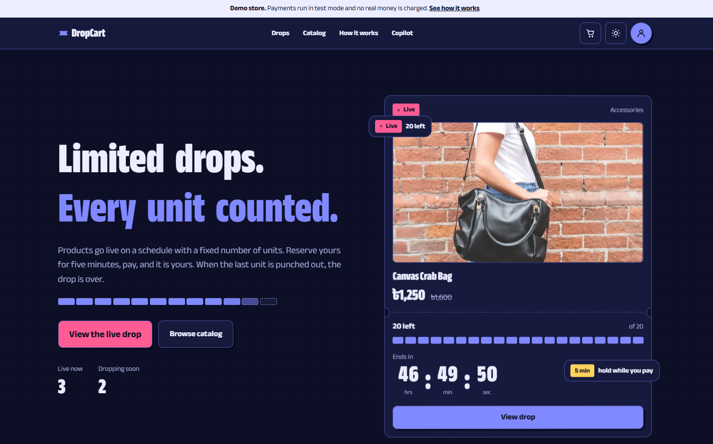
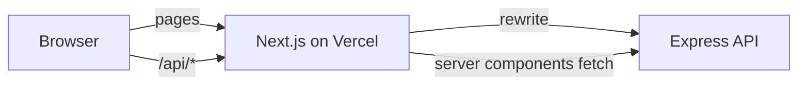

# DropCart


**A limited-drop store where every unit is counted.** Products go on sale in scheduled drops with a fixed number of units. Reserve one while the drop is live, pay within five minutes, and if you do not, the unit goes back to the drop for the next person.

- **Live demo:** <https://dropcart-client.vercel.app> (no sign-up needed, choose "Continue as a guest")
- **API repository:** [dropcart-server](https://github.com/tawchifulislam/dropcart-server), with the concurrency design, test results and architecture notes
- **How it is built, in the app:** <https://dropcart-client.vercel.app/about>



> The demo runs on free hosting. If the first load is slow, the API was asleep and needs about a minute to wake up.

## Try it in 60 seconds

1. Open the demo and choose **Continue as a guest**. A temporary account is created and deleted after a day.
2. Open a **live drop** and press **Reserve**. One unit is taken from the stock and held for five minutes while a timer runs.
3. Press **Pay** and use the test card `4242 4242 4242 4242`, any future date, any CVC. No real money is charged.
4. Open the **Copilot** and ask for a gift under 2000 taka. Then ask for something that does not exist and watch it say so.
5. Open **My account** to see your reservation history and receipt.

The admin dashboard needs a privileged account, so it is shown in the screenshots rather than opened to the public. Credentials for a limited admin account can be shared on request.

## Highlights

- **A UI built around one idea:** a torn ticket. Drops are tickets, units are cells that punch out, buttons press down like stamps. It is a custom design system, not a component kit.
- **Live, honest numbers.** Stock and timers update while you watch. Hold timers use the remaining time sent by the server, so a wrong device clock does not matter.
- **A route map** on `/how-it-works` that draws itself as you scroll and shows what happens to a unit from schedule to receipt.
- **An AI copilot** that searches the real catalog, shows product cards from database data and adds items to your cart. It never invents a product.
- **Admin dashboard** with live stock, a revenue chart, product and drop management, and role management. Admins only see their own data.
- **Production details:** light and dark themes without a flash, skeletons, error and 404 pages, a styled confirmation dialog, toasts for minor confirmations, social preview image and favicon, sitemap and structured data.

## Screens

<details>
<summary><strong>All routes</strong></summary>

| Route | Description |
| --- | --- |
| `/` | Landing page: animated hero, ticker, live drops, how it works, copilot, categories, FAQ |
| `/about` | Case study: architecture, engineering decisions, how it is verified |
| `/drops`, `/drops/[id]` | Live and upcoming drops, drop page with live stock, hold timer and Reserve |
| `/products`, `/products/[slug]` | Catalog with live search, filters, pagination, product detail |
| `/how-it-works` | Animated route map of a unit, and FAQ |
| `/cart` | Saved items with drop availability |
| `/copilot` | AI shopping assistant |
| `/checkout/[reservationId]`, `/checkout/complete` | Order review, hosted payment, receipt |
| `/account` | Profile, role, reservation history |
| `/admin` | Dashboard with live stock and a revenue chart |
| `/admin/products`, `/admin/drops` | Product and drop management |
| `/admin/users` | Role management (superadmin only) |
| `/login`, `/register` | Authentication, with guest access in demo mode |

</details>

## Design system

- **Tokens.** All colors, radii, shadows and motion live as CSS variables in `src/app/globals.css` and are exposed to Tailwind through `@theme`. Light and dark themes swap the variables, so components never hard-code a color.
- **Motifs.** Perforated dividers with half-circle notches (`.ticket`), stock cells that punch out (`.cells`), hard offset shadows that collapse on press (`.btn`), a stamped "Sold out" badge.
- **Type.** One variable family (Anek Bangla, Latin glyphs) in a narrow, heavy cut for display text and a regular cut for body copy.
- **Theming.** The theme is set before first paint from `localStorage` or the system preference, so there is no flash.
- **Motion.** Framer Motion for scroll reveals, the route map and the hero. Everything respects `prefers-reduced-motion`.

## Architecture



- **Server components** fetch public data (catalog, drops) directly from the API with `cache: "no-store"`, because drop status depends on the clock.
- **Client components** call `/api/*`. A rewrite in `next.config.ts` forwards that path to the API, so the session cookie belongs to the web app's own domain. No CORS and no third-party cookie problems.
- **Auth state** lives in `AuthProvider`. Admin pages check the role in the UI for convenience, and the API enforces it again on every request.
- **Live data** (stock, hold timers) is polled every few seconds while the tab is visible.
- **Security headers** (`nosniff`, frame denial, referrer and permissions policies) are set in `next.config.ts`.

## Tech stack

Next.js 16 (App Router), React 19, TypeScript, Tailwind CSS 4, Framer Motion, Recharts. Deployed on Vercel, with GitHub Actions running lint, type check and a production build on every push.

## Getting started

Requirements: Node 20 or newer and a running [dropcart-server](https://github.com/tawchifulislam/dropcart-server).

```bash
git clone https://github.com/tawchifulislam/dropcart-client.git
cd dropcart-client
npm install
cp .env.example .env.local
npm run dev
```

Open <http://localhost:3000>.

<details>
<summary><strong>Environment variables</strong></summary>

| Name | Required | Description |
| --- | --- | --- |
| `API_URL` | yes | Base URL of the API, without a trailing slash. Read at build time for the `/api/*` rewrite, so changing it needs a redeploy |
| `NEXT_PUBLIC_SITE_URL` | recommended | Public URL of this site, used for metadata, the sitemap and structured data |
| `NEXT_PUBLIC_DEMO_MODE` | no | `true` shows the demo banner, the test-card hint and the guest sign-in option |
| `NEXT_PUBLIC_REPO_URL`, `NEXT_PUBLIC_API_REPO_URL` | no | Source links shown in the footer and on `/about` |

</details>

<details>
<summary><strong>Scripts and project structure</strong></summary>

| Command | What it does |
| --- | --- |
| `npm run dev` | Development server |
| `npm run build`, `npm start` | Production build and server |
| `npm run lint` | ESLint |
| `npx tsc --noEmit` | Type check |

```text
src/
  app/            routes, layouts, metadata, icons and the social preview image
  components/     UI building blocks, feature components, admin screens
  lib/            API clients, formatting, shared types, navigation, FAQ content
public/
  products/       product photos
  docs/           README images
```

</details>

## Deployment

Deployed on Vercel.

1. Import the repository, framework preset Next.js.
2. Set `API_URL` **before** the first build. Set `NEXT_PUBLIC_SITE_URL` once the production URL is known, then redeploy.
3. Point the API's `CLIENT_ORIGIN` to the production URL.

Every push to `main` deploys automatically.

## Accessibility

- Semantic landmarks, a skip link, and visible focus rings.
- Timers expose their value through `role="timer"`. Stock cells have text alternatives.
- Forms have labels, inline errors and `aria-invalid` and `aria-describedby`.
- The confirmation dialog uses the native `<dialog>` element, which traps focus and closes on Escape.
- Status changes use polite live regions. Toasts are used for minor confirmations only, and errors that need action stay on the page.
- Motion is reduced when the user prefers it.

An automated audit (Lighthouse and axe) is on the list of next steps, so no scores are claimed here.

## Known limitations and next steps

- The free API host sleeps when idle, so the first request after a quiet period can be slow.
- Product images are URLs or files in `public/products`. There is no upload flow yet.
- Stock and timers are polled, not pushed. Server-sent events would be the next step for very large audiences.
- The interface is English only. Prices are in Bangladeshi taka and times are shown in Dhaka time (GMT+6).
- There are no component or end-to-end tests yet. Playwright for the reservation and checkout path is the natural next step.

## License

MIT. See [LICENSE](LICENSE).
