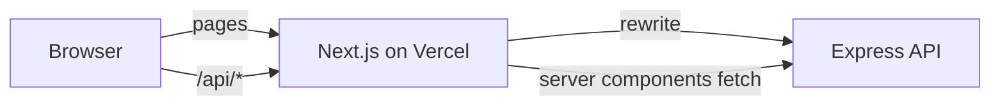

# DropCart

The web app for **DropCart**, a limited-drop store where products go on sale in scheduled, stock-limited drops. Each unit is counted, held for five minutes while you pay, and released back to the drop if you do not.

- Live demo: <https://dropcart-client.vercel.app>
- API repository: [dropcart-server](https://github.com/tawchifulislam/dropcart-server)

<!-- Add screenshots here: home, drop page, checkout receipt, copilot, admin dashboard -->

## What you can do

- Browse the catalog at any time, and see live and upcoming drops with real-time stock and countdowns.
- Reserve a unit while a drop is live, then pay before the hold timer runs out.
- Ask the **Copilot** for products within a budget. It searches the real catalog and fills your cart.
- Follow your reservations and receipts from your account page.
- As an admin, manage your own products and drops and watch live stock and revenue.

## Screens

| Route | Description |
| --- | --- |
| `/` | Landing page: animated hero, ticker, live drops, how it works, copilot, categories, FAQ |
| `/drops`, `/drops/[id]` | Live and upcoming drops, drop page with live stock, hold timer and Reserve |
| `/products`, `/products/[slug]` | Catalog with live search, filters, pagination, product detail |
| `/how-it-works` | Animated route map of a unit, and FAQ |
| `/cart` | Saved items with drop availability |
| `/copilot` | AI shopping assistant |
| `/checkout/[reservationId]`, `/checkout/complete` | Order review, hosted payment, receipt |
| `/account` | Profile, role, reservation history |
| `/admin` | Dashboard with live stock and a revenue chart |
| `/admin/products`, `/admin/drops` | Product and drop management |
| `/admin/users` | Role management (superadmin only) |
| `/login`, `/register` | Authentication |

## Design system

The look is built around one idea: a torn ticket. Every drop is a ticket, every unit is a cell, and a purchase punches one out.

- **Tokens.** All colors, radii, shadows and motion live as CSS variables in `src/app/globals.css` and are exposed to Tailwind through `@theme`. Light and dark themes swap the variables, so components never hard-code a color.
- **Motifs.** Perforated dividers with half-circle notches (`.ticket`), stock cells that punch out (`.cells`), hard offset shadows that collapse on press (`.btn`), a stamped "Sold out" badge.
- **Type.** One variable family (Anek Bangla, Latin glyphs) used in a narrow, heavy cut for display text and a regular cut for body copy.
- **Theming.** The theme is set before first paint from `localStorage` or the system preference, so there is no flash. A toggle sits in the header.
- **Motion.** Framer Motion for scroll reveals, the route map and the hero. Everything respects `prefers-reduced-motion`.

## Architecture



- **Server components** fetch public data (catalog, drops) directly from the API with `cache: "no-store"` because drop status depends on the clock.
- **Client components** call `/api/*`. A rewrite in `next.config.ts` forwards that path to the API, so the session cookie belongs to the web app's own domain. No CORS and no third-party cookie issues.
- **Auth state** lives in `AuthProvider`. Admin pages check the role in the UI for convenience, and the API enforces it again on every request.
- **Live data** (stock, hold timers) is polled every few seconds while the tab is visible. Timers use the remaining time sent by the server, so a wrong device clock does not matter.

## Tech stack

Next.js 16 (App Router), React 19, TypeScript, Tailwind CSS 4, Framer Motion, Recharts.

## Getting started

Requirements: Node 20 or newer and a running [dropcart-server](https://github.com/tawchifulislam/dropcart-server).

```bash
git clone https://github.com/tawchifulislam/dropcart-client.git
cd dropcart-client
npm install
cp .env.example .env.local
npm run dev
```

Open <http://localhost:3000>.

## Environment variables

| Name | Required | Description |
| --- | --- | --- |
| `API_URL` | yes | Base URL of the API, without a trailing slash. Read at build time for the `/api/*` rewrite, so changing it needs a redeploy |
| `NEXT_PUBLIC_SITE_URL` | recommended | Public URL of this site, used for metadata, the sitemap and structured data |
| `NEXT_PUBLIC_DEMO_MODE` | no | `true` shows a demo banner and the test-card hint at checkout |
| `NEXT_PUBLIC_REPO_URL`, `NEXT_PUBLIC_API_REPO_URL` | no | Source links shown in the footer |

## Scripts

| Command | What it does |
| --- | --- |
| `npm run dev` | Development server |
| `npm run build`, `npm start` | Production build and server |
| `npm run lint` | ESLint |
| `npx tsc --noEmit` | Type check |

## Project structure

```text
src/
  app/            routes, layouts, metadata, icons and the social preview image
  components/     UI building blocks, feature components, admin screens
  lib/            API clients, formatting, shared types, navigation, FAQ content
public/
  products/       product photos
```

## Deployment

Deployed on Vercel.

1. Import the repository, framework preset Next.js.
2. Set `API_URL` **before** the first build. Set `NEXT_PUBLIC_SITE_URL` once the production URL is known, then redeploy.
3. Point the API's `CLIENT_ORIGIN` to the production URL.

Every push to `main` deploys automatically.

## Accessibility

- Semantic landmarks, a skip link, and visible focus rings.
- Timers expose their value through `role="timer"`. Stock cells have text alternatives.
- Forms have labels, inline errors and `aria-invalid` and `aria-describedby`.
- Status changes use polite live regions. Toasts are used for minor confirmations only. Errors that need action stay on the page.
- Motion is reduced when the user prefers it.

## Known limitations

- The free API host sleeps when idle, so the first request after a quiet period can be slow.
- Product images are URLs or files in `public/products`. There is no upload flow yet.
- Stock and timers are polled, not pushed. Server-sent events would be the next step for very large audiences.
- The interface is English only.
